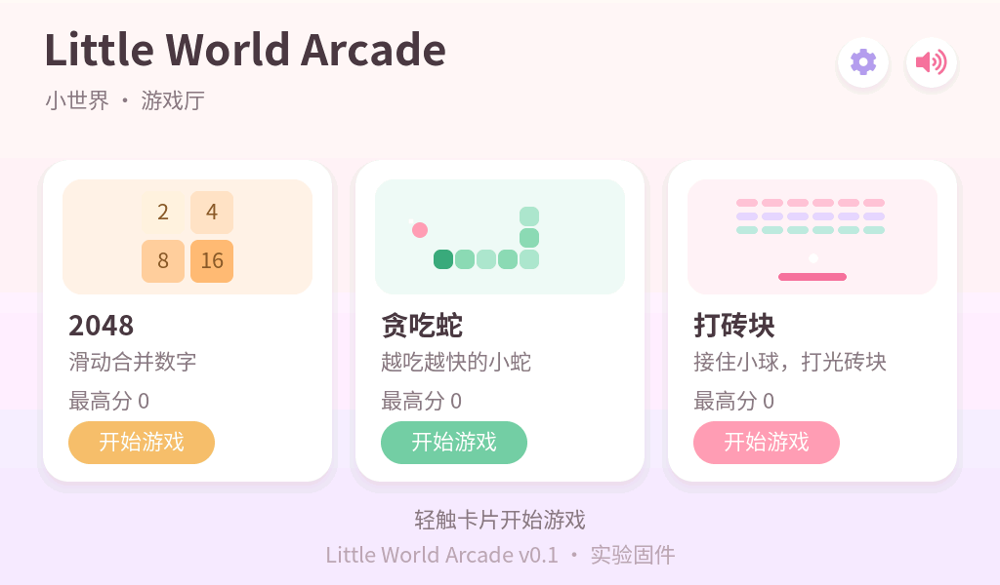

# Little World Arcade

Little World 的独立实验固件：在 **Waveshare ESP32-P4-WIFI6-Touch-LCD-7B**（7 英寸 1024×600、GT911 触摸、ESP32-P4 v3.2、32 MB Flash）上运行的小游戏厅。

公开仓库：<https://github.com/Start66613/littleworld-arcade>（源码 + 文档 + 模拟器截图；整片固件备份与设备原始日志**不在**仓库里）。

它是正式工程 `C:\Projects\LittleWorld` 的旁支实验，**不修改、不覆盖正式工程**，但复用正式工程已验证的工具链与官方 BSP 版本。

## 界面预览（PC 模拟器真实渲染）



这些截图来自 `host_sim/`：把同一份 `arcade_ui` + `arcade_core` + 字体编译进桌面版 LVGL 9.5，
用脚本模拟触摸后直接读显存导出，不是效果图。更多截图与验证说明见 [docs/UI.md](docs/UI.md)。

模拟器同时做自动化检查：三个游戏的开/关/暂停/继续/重开、2048 滑动、打砖块拖拽、21 次页面开合对象数不增长。

```powershell
pwsh -NoProfile -ExecutionPolicy Bypass -File tools/run_sim.ps1
```

## 当前状态（如实）

| 项目 | 状态 |
|---|---|
| 三款游戏规则（2048 / 贪吃蛇 / 打砖块） | 已实现，主机单元测试通过（1393 项检查） |
| LVGL 9 界面（菜单 / 游戏页 / 暂停 / 结算 / 音效开关 / 最高分） | 已实现，本机编译通过 |
| PC 模拟器渲染 + 交互回归（含 21 次开合无对象增长） | 通过（见 `docs/UI.md`） |
| ESP-IDF 固件（esp32p4、rev3_x、32 MB） | 本机编译通过，产物含 v3.0+ 芯片修订头 |
| 实板运行、触摸、流畅度 | **未进行板上测试**（尚未刷机） |
| 出厂固件整片备份 | **已完成并双读校验**（SHA-256 一致） |
| 已验证的回滚路径 | 整片备份可写回；另有源码重建的 Brookesia 桌面兜底（见 `docs/RECOVERY.md`） |

> 编译通过 ≠ 板上验证。任何“屏幕正常/触摸正常/流畅”的说法都必须等实板测试后才能写。

## 结构

```
firmware/                     ESP-IDF 工程（idf.py 在这里运行）
  components/arcade_core/     纯 C 游戏规则，不依赖 IDF/LVGL，可主机测试
  components/arcade_ui/       LVGL 9 界面、导航、NVS 存档、字体
  main/app_main.c             仅负责 BSP 显示初始化并启动 UI
tools/                        环境激活、构建、主机测试、字体生成脚本
tests/host/                   MSVC 主机单元测试
docs/                         状态、构建说明、恢复方案、许可清单
reports/logs/                 本地构建日志（不入库）
```

设计约束：
- 游戏规则（`arcade_core`）与渲染/输入完全分离，后续可移植进正式 Little World 桌面框架。
- 每个游戏一个模块，统一 `create/destroy/set_paused` 生命周期，退出时删除 LVGL 定时器，避免重复进出造成泄漏。
- 没有阻塞式业务循环：贪吃蛇/打砖块用 LVGL 定时器驱动，2048 完全事件驱动。
- 无图片资源：全部用 LVGL 原生图形（圆角、色块、渐变）。
- 中文字体是 Noto Sans SC 子集（SIL OFL 1.1），只包含源码里真实出现的字符，由 `tools/gen_fonts.ps1` 生成。

## 构建

```powershell
# 环境（复用 D:\Espressif\LittleWorld 里已装好的 ESP-IDF v5.5.5，不重新安装）
. .\tools\activate_env.ps1

# 主机单元测试（MSVC，在 D:\LittleWorld-Arcade\build\host_tests 下）
pwsh -NoProfile -ExecutionPolicy Bypass -File .\tools\run_host_tests.ps1

# 生成中文子集字体（源码里改了中文文案后需要重跑）
pwsh -NoProfile -ExecutionPolicy Bypass -File .\tools\gen_fonts.ps1

# 固件编译（产物在 D:\LittleWorld-Arcade\build，不写 C 盘）
pwsh -NoProfile -ExecutionPolicy Bypass -File .\tools\build.ps1 -ImageInfo
```

## 安全边界

- 本仓库**不包含**烧录脚本，也不会自动打开串口。
- 未获得用户针对这一次写入的明确许可前，不得 flash / erase / 修改分区 / 写 C6 / 动 eFuse。
- 出厂整片备份还没有，因此当前不具备可靠回滚能力；在完成备份之前不应刷机。

## 许可

- 本项目代码：MIT（见 `LICENSE`）。
- LVGL 9.5.0：MIT。Waveshare BSP 3.0.1 与 esp_lvgl_adapter 0.6.4：Apache-2.0。
- 字体：Noto Sans SC，SIL Open Font License 1.1，完整文本见 `firmware/components/arcade_ui/fonts/OFL.txt`。
- 参考过的开源项目仅用于理解玩法，**没有复制其代码或素材**，详见 `docs/LICENSES.md`。
